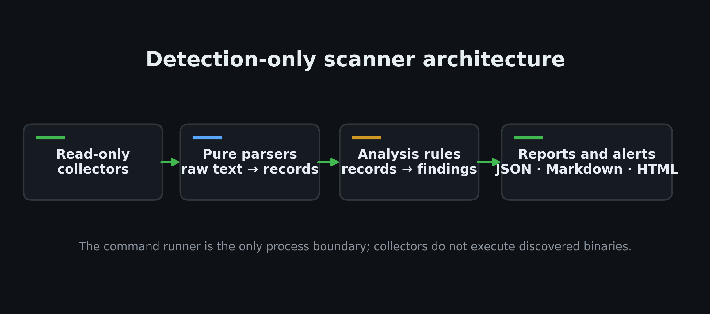

# Linux Privilege Escalation Automation Toolkit

[](https://www.python.org/downloads/)
[](LICENSE)
[](docs/DECISIONS.md)

**Author:** Vansh Dhawan  
**Company:** Vecesta.co  
**Internship:** Unified Mentor  
**Date:** 10 November 2026  

A detection-only Linux security auditing toolkit for authorized systems. The toolkit inspects configuration evidence, applies small, explainable rules, and exports structured reports in JSON, Markdown, and self-contained HTML. It **never exploits**, **never modifies system files**, and **never executes payloads**.

Designed for dual-use in red-team enumeration and blue-team auditing practice.

---

## Architecture



```
linux-privesc-toolkit/
├── privesc_scan.py               # CLI entry point (scan, compare, render)
├── run_scan.sh                   # Bash wrapper (checks python3, runs scan)
├── privesc/                      # Core scanner package
│   ├── runner.py                 # Safe read-only command runner (strict allowlist)
│   ├── models.py                 # Finding, ScanResult dataclasses
│   ├── scan.py                   # Scan orchestrator and event logger
│   ├── analysis.py               # Rule catalog and risk assignment
│   ├── report.py                 # JSON, Markdown, HTML, and console formatters
│   ├── compare.py                # Differential scan comparison (NEW/FIXED)
│   ├── modules/                  # Collectors and pure parsers
│   │   ├── sysinfo.py            # OS, kernel, user, container/WSL detection
│   │   ├── suid.py               # SUID/SGID discovery with GTFOBins matching
│   │   ├── perms.py              # World-writable files, sensitive config paths
│   │   ├── services.py           # systemd unit parser (ExecStart, PATH)
│   │   ├── sudo.py               # Sudo policy parser (NOPASSWD, GTFOBins)
│   │   ├── cron.py               # Crontab, spool, wildcard and path checks
│   │   ├── caps.py               # Linux file capabilities via getcap
│   │   └── kernel.py             # Kernel version and CVE range matching
│   └── data/                     # Offline reference databases
│       ├── gtfobins.json         # Binaries with privilege implications
│       ├── suid_standard.json    # Standard system SUID allowlist
│       ├── kernel_cves.json      # Known local privilege escalation CVEs
│       ├── kernel_eol.json       # Upstream kernel EOL series
│       └── dangerous_caps.json   # High-risk Linux capability catalog
├── lab/                          # Disposable validation lab
│   ├── setup_lab.sh              # Plants 7 reversible weaknesses
│   ├── teardown_lab.sh           # Manifest-driven cleanup
│   └── run_lab_demo.sh           # 3-act automated demo script
├── tests/                        # 29 unit and integration tests (pytest)
├── tools/                        # Verification, rendering, documentation tools
│   ├── verify_all.py             # Automated evidence verification
│   ├── render_terminal_png.py    # Terminal screenshot generator
│   └── make_docs.py              # Report, diagram, presentation builder
├── docs/                         # Reports, guides, and presentations
│   ├── Project_Report.docx       # Full comprehensive internship report
│   ├── Project_Report.pdf        # PDF export
│   ├── Final_Presentation.pptx   # 15-slide dark terminal theme deck
│   ├── CODE_WALKTHROUGH.md       # Plain-English per-file walkthrough
│   ├── LINUX_TEST_GUIDE.md       # Copy-paste Kali/WSL execution instructions
│   ├── RECORDING_GUIDE.md        # Screen-recording guide with script
│   ├── SUBMISSION_CHECKLIST.md   # Final pre-submission checklist
│   ├── TRACEABILITY_MATRIX.md    # Requirement-to-evidence matrix
│   └── DECISIONS.md              # Engineering decision log
└── evidence/                     # Execution evidence, logs, and screenshots
```

---

## Ethics and Authorization Warning

> [!WARNING]
> This toolkit is designed solely for authorized security audits, educational demonstrations, and defense assessments.
> Running privilege escalation scans against systems without explicit prior written authorization is illegal and unethical.
> The authors and contributors assume no liability for misuse.

---

## Key Features

1. **Detection Only / Zero Payloads**: The scanner never attempts exploitation, never creates or alters files outside its output directory, and never executes discovered binaries.
2. **Safe Command Execution**: `privesc/runner.py` is the only external execution path. It enforces a strict allowlist (`find`, `uname`, `id`, `getcap`, `crontab`, `sudo -n -l`, `systemctl cat/show`), rejects dangerous arguments (`-exec`, `-delete`), uses timeouts, and disallows shell interpolation (`shell=False`).
3. **Pure Function Separation**: Collectors gather raw data on Linux; parsers and rules are pure functions that execute on any OS. The entire test suite runs on Windows without Linux emulation.
4. **Structured Multi-Format Reporting**: Generates JSON (machine-readable), Markdown (readable/git-friendly), self-contained HTML (with inline styles and severity chips), and colored console output.
5. **Differential Comparison**: `compare OLD.json NEW.json` computes fingerprints to report `NEW`, `FIXED`, and `UNCHANGED` findings across scans.
6. **Simulated Kernel Flag**: The `--kernel-override` option allows demonstrating kernel CVE matching while clearly displaying a `SIMULATED KERNEL VERSION` banner in logs, console, and reports.

---

## Requirements

### Runtime (Target System)
- Linux (Ubuntu, Debian, Kali, CentOS, Fedora, Arch)
- Python 3.10+ (standard library only; zero runtime pip packages)
- Standard utilities: `find`, `uname`, `id` (optional: `getcap`, `sudo`, `crontab`, `systemctl`)

### Development & Documentation (Optional)
- Python 3.10+
- Dependencies listed in `requirements-dev.txt`:
  - `pytest` (test execution)
  - `python-docx` (DOCX report generation)
  - `python-pptx` (presentation generation)
  - `Pillow` (terminal screenshot rendering)
  - `matplotlib` (flowchart and architecture diagrams)
  - `pymupdf` (PDF page rasterization)

---

## Kali Linux Evidence Collection Quick Start

For automated evidence collection on a disposable Kali Linux VirtualBox VM or native Linux host:

```bash
# 1. Unzip the handoff package or clone the repository on Kali Linux
unzip linux-privesc-toolkit-handoff.zip -d linux-privesc-toolkit
cd linux-privesc-toolkit

# 2. Run the one-command evidence collector (checks preflight, pytest, runs demo 1 & 2, packages bundle)
sudo bash lab/collect_evidence.sh --yes

# 3. Transfer the generated evidence-bundle-*.zip back to host incoming/ folder
# On host Windows machine, ingest and verify:
python tools/ingest_evidence.py incoming/evidence-bundle-*.zip
python tools/make_docs.py --final
```

Detailed transfer methods and troubleshooting instructions are documented in [docs/KALI_HANDOFF_GUIDE.md](docs/KALI_HANDOFF_GUIDE.md).

---

## Tested On

- **Host (Development & Unit Verification):** Windows 11, Python 3.11.9 (all 29 unit & safety tests PASS, 1 Linux-only integration test skipped as expected).
- **Target Linux System (Evidence Collection):** PENDING REAL RUN — to be filled from `evidence/env_info.txt` after Kali Linux evidence collection bundle ingestion.

---

## Quick Start (Linux / WSL / Kali)

### 1. Basic Scan

```bash
# Clone or copy repository into a Linux environment (ext4)
cd linux-privesc-toolkit

# Run a fast audit scan (pruning /proc, /sys, /dev, /mnt)
python3 privesc_scan.py scan --fast --label audit_01

# Inspect reports
ls -la reports/
# reports/scan_audit_01.json
# reports/scan_audit_01.md
# reports/scan_audit_01.html
```

### 2. Compare Two Scans

```bash
# Scan before remediation
python3 privesc_scan.py scan --fast --label before

# ... perform system hardening ...

# Scan after remediation
python3 privesc_scan.py scan --fast --label after

# Compare findings
python3 privesc_scan.py compare reports/scan_before.json reports/scan_after.json
```

### 3. Re-render Reports on Any OS (including Windows)

```bash
# Re-generate Markdown and HTML from an existing JSON scan file
python privesc_scan.py render reports/scan_act2_lab.json --format md,html
```

---

## Command Reference

```
usage: privesc_scan.py [-h] [--version] {scan,compare,render} ...

Detection-only Linux privilege-escalation audit toolkit

positional arguments:
  {scan,compare,render}
    scan                collect read-only Linux security configuration
    compare             compare two JSON scan reports
    render              re-render reports from JSON on any operating system

scan arguments:
  --modules MODULES     comma-separated modules (default: sysinfo,suid,perms,services,sudo,cron,caps,kernel)
  --fast                limit filesystem traversal to common system directories
  --exclude PATH        exclude absolute path from file search (can be repeated)
  --timeout SECONDS     command timeout in seconds (default: 8.0)
  --label NAME          scan label for filenames (default: scan)
  --output-dir DIR      directory for reports (default: reports)
  --log-dir DIR         directory for logs (default: logs)
  --format FORMATS      comma-separated output formats: json,md,html (default: all)
  --kernel-override VER simulated kernel version for testing/demo
  --no-color            disable ANSI terminal colors
```

---

## Disposable Validation Lab

The `lab/` directory provides an automated, self-contained test environment designed for disposable VMs or containers:

| Weakness | Component | Rule ID | Description |
|---|---|---|---|
| L1 | `/opt/privesc-lab/find_suid` | `SUID-001`, `SUID-002` | SUID copy of find with GTFOBins exploitation potential |
| L2 | `/opt/privesc-lab/world_writable.conf` | `PERM-001` | World-writable configuration file (0666) |
| L2 | `/opt/privesc-lab/open_dir` | `PERM-002` | World-writable directory without sticky bit (0777) |
| L3 | `/etc/cron.d/privesc-lab` | `CRON-001`, `CRON-002`, `CRON-003` | Root cron job running writable script with wildcards |
| L4 | `/etc/sudoers.d/privesc-lab` | `SUDO-001`, `SUDO-002`, `SUDO-003` | Sudo NOPASSWD grant for GTFOBins binary and ALL |
| L5 | `/etc/systemd/system/privesc-lab.service` | `SVC-001`, `SVC-002`, `SVC-003` | Unstarted service running as root with writable script and insecure PATH |
| L6 | `/opt/privesc-lab/python_cap` | `CAP-001`, `CAP-002` | Python binary with `cap_setuid+ep` file capability |
| L7 | `/home/privlab` | `PERM-004` | Lab account home directory with permissive mode (0777) |

### Running the 3-Act Demo

```bash
# Must be executed as root in a disposable environment
sudo bash lab/run_lab_demo.sh --out evidence/run1 --pace 3

# Validate that all expected findings were detected and safely removed
python3 tools/verify_all.py evidence/run1
```

---

## Sample Finding Output

```json
{
  "id": "SUID-001",
  "category": "suid",
  "title": "Non-standard SUID binary found",
  "severity": "High",
  "confidence": "High",
  "evidence": {
    "path": "/opt/privesc-lab/find_suid",
    "mode": "-rwsr-xr-x",
    "owner": "root",
    "group": "root"
  },
  "exploitation": "A non-standard SUID executable runs with root privileges. If it contains logic flaws, shell escapes, or relative library loads, a local user may escalate privileges.",
  "mitigation": "Remove the SUID bit if not required: chmod u-s /opt/privesc-lab/find_suid",
  "references": [
    "https://gtfobins.github.io/gtfobins/find/",
    "https://attack.mitre.org/techniques/T1548/001/"
  ],
  "module": "suid",
  "fingerprint": "SUID-001:/opt/privesc-lab/find_suid"
}
```

---

## Testing

Run the full pytest suite:

```bash
# Using Python virtual environment
pytest tests/ -v

# Verification coverage includes:
# - Pure parser tests (uname, os-release, find, crontab, sudoers, systemd, getcap)
# - Analysis engine rule tests (positive matches and false-positive guards)
# - Safety tests (runner allowlist enforcement, dangerous argument rejection)
# - Static code analysis (asserting zero forbidden mutation APIs in source)
# - Multi-format report generation (JSON, Markdown, HTML)
# - Differential comparison engine
```

---

## Limitations and Operational Bounds

1. **Vendor Backports**: Kernel CVE checks compare version strings against known vulnerable upstream ranges. Linux distributions (such as Debian, Ubuntu, Red Hat) backport security patches without changing the major/minor version. Kernel findings must be validated against distribution errata.
2. **Limited-User Visibility**: When executed as an unprivileged user, the scanner cannot read protected files (such as `/etc/shadow`, restricted crontabs, or `/etc/sudoers`). Such paths are explicitly marked `SKIPPED` in the coverage report.
3. **Platform Boundary**: The live scanner requires Linux syscalls and filesystems. On Windows, the scanner safely exits with code 2, while the report renderer, comparison tool, and all unit tests remain fully functional.

---

## License

This project is licensed under the MIT License — see the [LICENSE](LICENSE) file for details.

